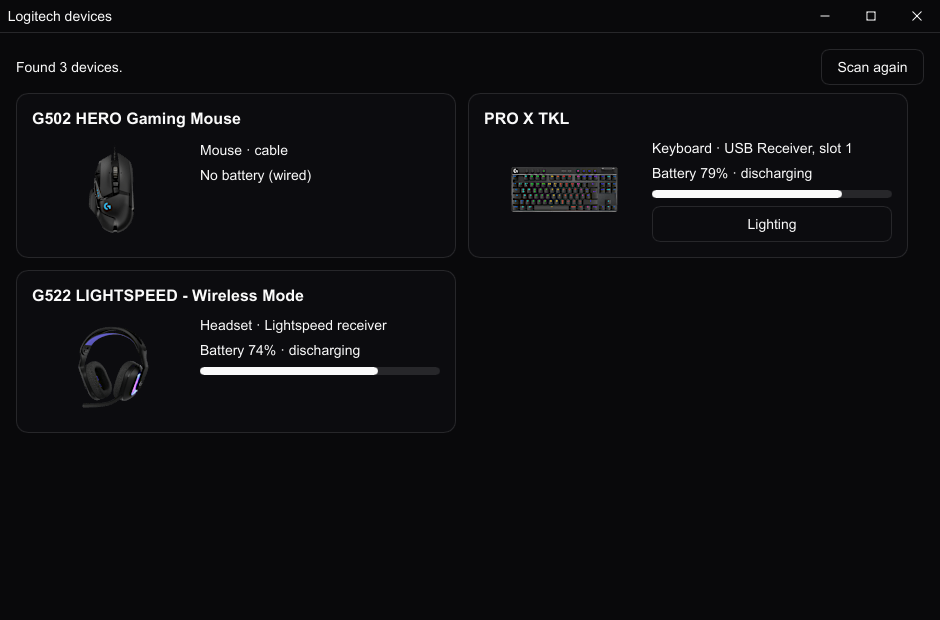
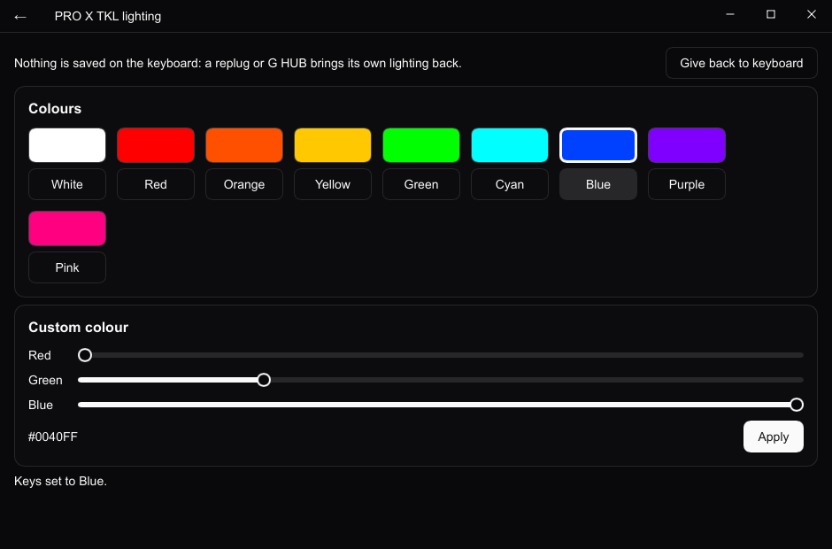

# glite

A small desktop app that lists your Logitech G devices with their picture, connection and battery,
and sets a LIGHTSYNC keyboard's colour without G HUB.

> **This is a demo project.** It shows what a [RageKit](https://github.com/hunwalk/ragekit) app can
> do with a native module. It isn't a G HUB replacement, it was tested on a single setup (a PRO X TKL,
> a G502 HERO and a G522 headset), and it runs on Windows only.





## What it does

- **Lists the devices** when it starts: their name, kind, how they're connected (cable, a receiver
  slot) and their battery, with a progress bar. "Scan again" refreshes the list.
- **Shows each device's picture**, found by name through Logitech's product search and loaded from
  their image CDN, already resized. Nothing is shipped with the app.
- **Sets a keyboard's lighting**: one colour for every key, from a swatch or red/green/blue
  sliders, and "Give back to keyboard" to restore its own effects. Nothing is written to the
  keyboard's memory: a replug or G HUB brings back its saved lighting too.
- **Draws its own title bar**: the screen's title, a back button on the lighting screen, and the
  minimise, maximise and close buttons. Drag it to move the window; double-click to maximise.

G HUB may keep running; glite talks to the devices directly.

## How it works

glite is PHP, compiled to a native executable by TypePHP, with a UI drawn by Slint. RageKit ties
those together: screens are PHP classes, their templates (`.rk`) compile to Slint.

The device side is a RageKit module, `modules/logi`: a C++ library loaded at run time, which
answers on a worker thread and posts events back to the UI.

- **HID++ 2.0** for the mouse and the keyboard, as [Solaar](https://github.com/pwr-Solaar/Solaar)
  speaks it: device names, battery (`0x1004`, `0x1000`, `0x1001`, `0x1F20`) and lighting
  (`0x8071` RGB effects, `0x8081` per-key lighting, `0x8100` onboard profiles).
- **Centurion** for newer headsets like the G522, ported from
  [HeadsetControl](https://github.com/Sapd/HeadsetControl): the receiver's bridge carries
  requests to the headset.

| Path | What it is |
|---|---|
| `src/Windows/AppWindow.php` | the window's frame: the custom title bar (`templates/Windows/AppWindow.rk`); screens give it their title through `TitleBar` |
| `src/Screens/HomeScreen.php` | the device list: scans when it opens, one card per device |
| `src/Screens/LightingScreen.php` | a keyboard's colour: swatches, sliders, give back |
| `src/Models/` | `DeviceCard` (what a card shows) and `DeviceCards`, the collection the template loops over |
| `src/Services/LogitechImages.php` | finds a device's picture through Logitech's product search |
| `templates/Screens/` | the screens' templates |
| `modules/logi/native/logi.cc` | the HID++ and Centurion code |
| `modules/logi/src/` | its PHP side: `Logi::scan()`, `Logi::light()`, `Logi::giveBack()`, `Device` |

## Build and run

Needs Windows, PHP 8.4+, Composer, git, 7-Zip and Visual Studio 2022 Build Tools ("Desktop
development with C++").

```sh
composer install
vendor/bin/ragekit setup     # installs the pinned TypePHP and Slint once
composer start               # build and start (vendor/bin/ragekit run)
composer dev                 # hot reload while editing templates or PHP
composer build               # compile only, into build/slint/ (add -- --nano for a Nano build)
```

`vendor/bin/ragekit doctor` reports anything missing from the toolchain.

## Limits

- Windows only; the module's other platforms return "Only Windows is supported for now".
- Lighting is one colour for the whole keyboard, on keyboards with per-key lighting (`0x8081`).
  Mice, headsets and per-key colours aren't done.
- Logitech's search API and image CDN aren't documented; they can change.

## Credits

- [Solaar](https://github.com/pwr-Solaar/Solaar): the HID++ requests and the battery voltage curve.
- [HeadsetControl](https://github.com/Sapd/HeadsetControl) (GPLv3): the Centurion protocol.
- Logitech, Logitech G, LIGHTSYNC and G HUB are trademarks of Logitech. This project isn't affiliated
  with Logitech.
